# Three-Tier Web App on AWS, built with Terraform

A production-style three-tier application on AWS, defined entirely as code. It serves a static frontend through CloudFront and S3, runs a Flask API on Auto Scaling EC2 instances in private subnets, and stores data in an encrypted PostgreSQL database on RDS. The database password is generated and stored by AWS Secrets Manager, and the application reads it at runtime through an IAM role, so no secret is ever written in code, in the repository or on a server.

Infrastructure changes are planned on every pull request and applied on merge to `main` through GitHub Actions, using OIDC so no AWS access keys are stored anywhere.

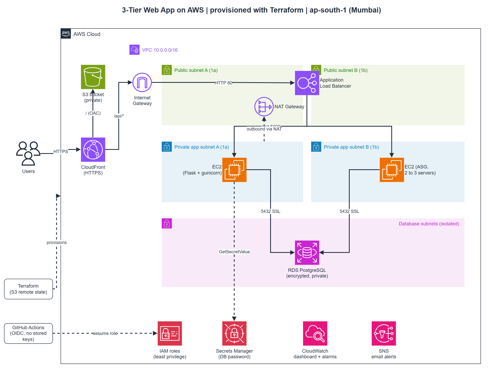

## Live application

The app is a small task manager. The page shows live API and database health, task count, API latency and the request path through the stack.

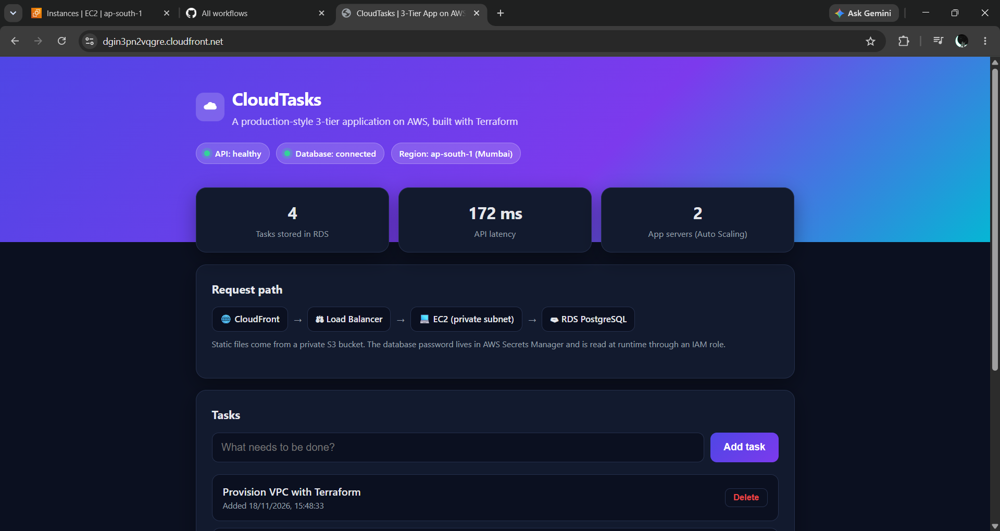

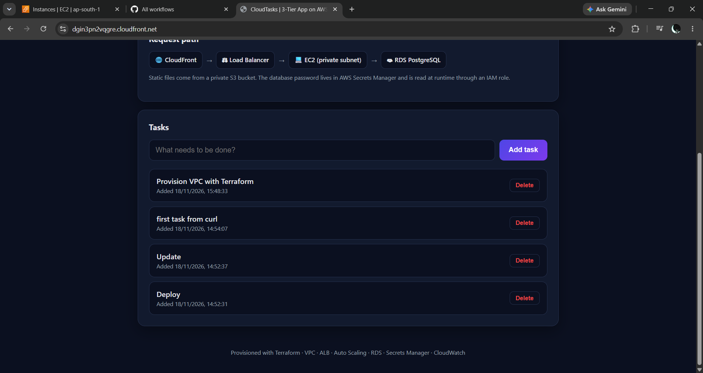

## What this project demonstrates

| Area | What I built |
|---|---|
| Infrastructure as Code | 5 reusable Terraform modules (network, database, compute, frontend, monitoring), 56 managed resources, remote state in S3 with native locking |
| Networking | VPC with public, private and isolated database subnets across 2 Availability Zones, Internet Gateway, NAT Gateway, layered security groups |
| Compute | Launch template and Auto Scaling Group (2 to 3 instances, CPU target tracking), Application Load Balancer, IMDSv2 only, encrypted EBS, no SSH (Session Manager instead) |
| Database | RDS PostgreSQL 16 in isolated subnets, encrypted at rest, not publicly accessible, SSL enforced from the app |
| Secrets and IAM | RDS-managed master password in AWS Secrets Manager, least-privilege instance role that can read exactly one secret |
| Content delivery | CloudFront with HTTPS redirect, private S3 bucket reached through Origin Access Control, `/api/*` routed to the ALB |
| Observability | CloudWatch dashboard, 6 alarms plus 2 autoscaling alarms, SNS email alerts, monthly cost budget |
| CI/CD | GitHub Actions: `fmt`, `validate` and `plan` on pull requests, `apply` on merge, authenticated with OIDC |

## Architecture

Traffic flow:

1. A user opens the CloudFront URL over HTTPS.
2. CloudFront serves static files from a private S3 bucket (access only through Origin Access Control).
3. Requests to `/api/*` are forwarded by CloudFront to the Application Load Balancer.
4. The ALB sends requests to Flask/gunicorn on EC2 instances in private subnets.
5. The app connects to RDS PostgreSQL in isolated subnets over SSL, using credentials it fetches from Secrets Manager.

Security design:

- Only the ALB and CloudFront are internet-facing. The instances have no public IP address.
- Security groups chain together: ALB, then app, then database. The database accepts connections only from the app security group.
- Database subnets have no route to the internet at all.
- Instances use an IAM role. The only data permission it has is `secretsmanager:GetSecretValue` on one secret.
- Shell access uses AWS Systems Manager Session Manager, so port 22 is never open.
- GitHub Actions assumes an AWS role through OIDC, so there are no long-lived keys.

### Network

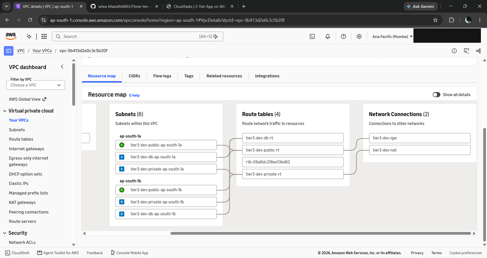

### Compute

Instances run in private subnets with no public IPv4 address, and the IMDSv2 token is required.

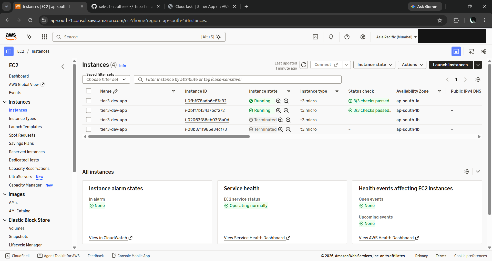

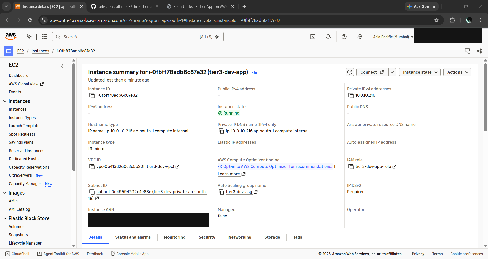

Both targets pass the load balancer health check.

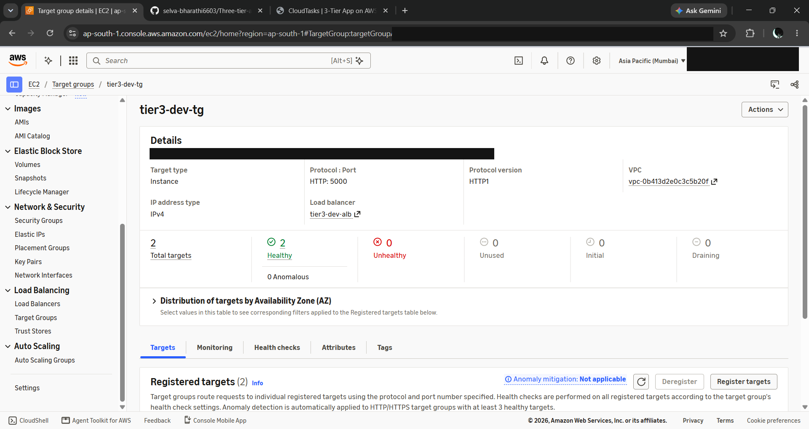

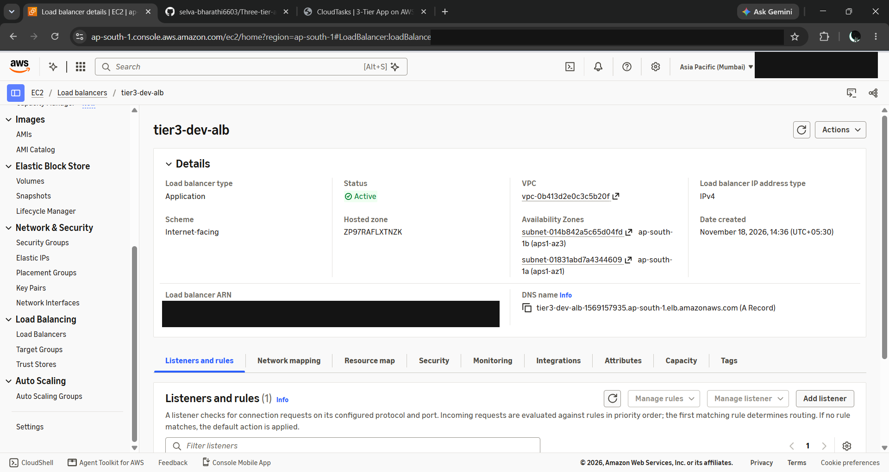

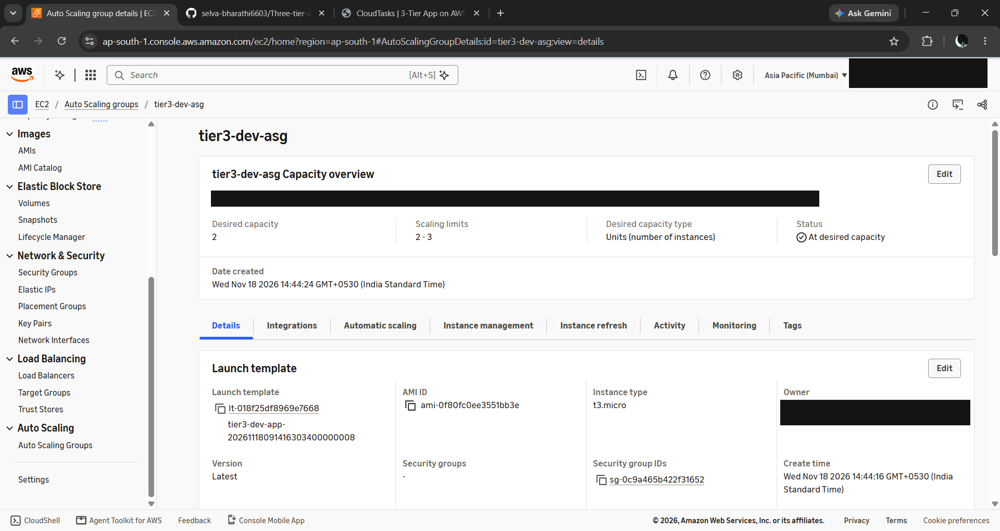

The Flask service, running under systemd and reached through Session Manager:

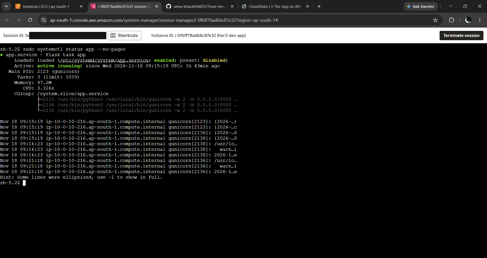

### Database and secrets

The database is private and encrypted, and its master credential is managed by Secrets Manager.

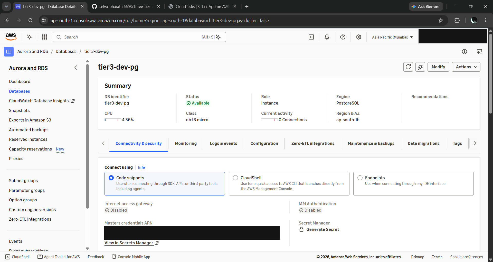

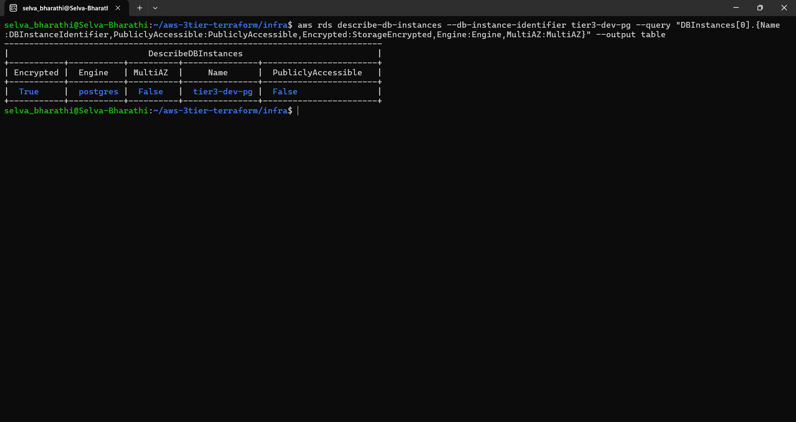

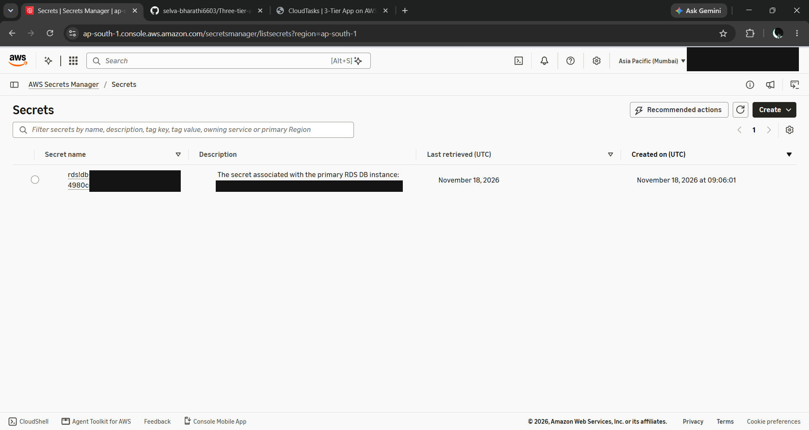

The instance role grants read access to only that one secret:

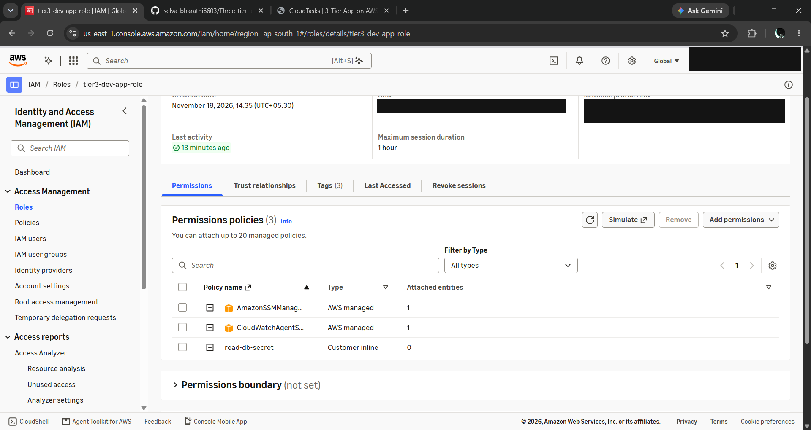

### Content delivery

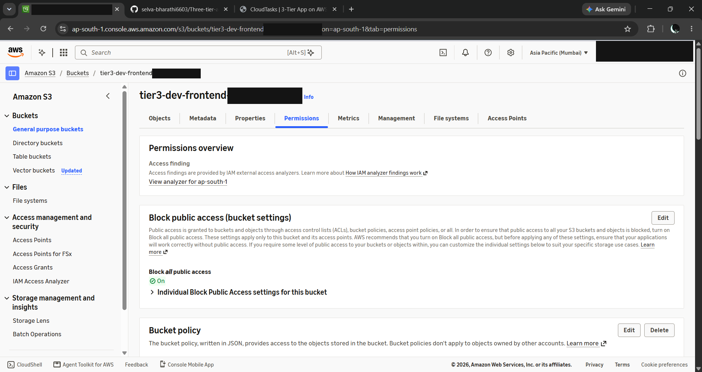

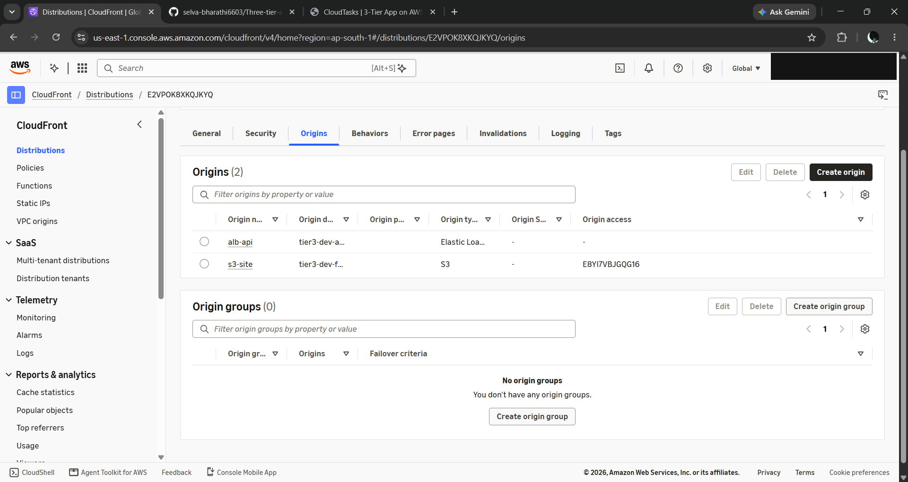

### Monitoring

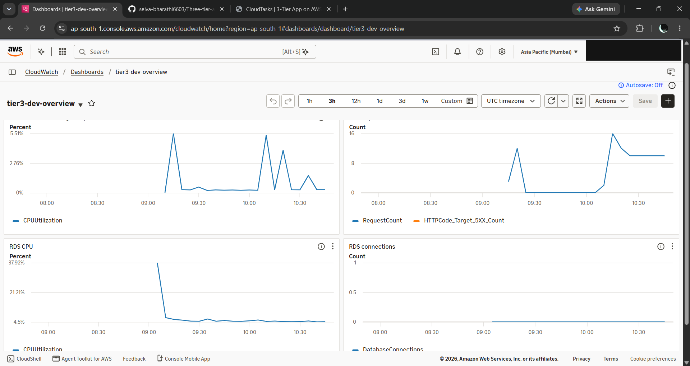

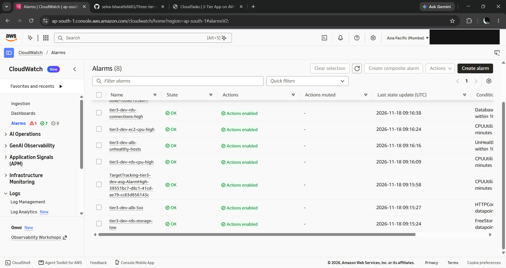

## Repository structure

```
.
├── README.md
├── .github/workflows/terraform.yml   CI/CD pipeline
├── app/                              Flask API (app.py, requirements.txt)
├── frontend/index.html               Static single-page UI
├── bootstrap/main.tf                 One-time: state bucket + GitHub OIDC role
├── infra/
│   ├── main.tf  variables.tf  outputs.tf  versions.tf
│   ├── backend.hcl.example  terraform.tfvars.example
│   └── modules/
│       ├── network/      VPC, subnets, NAT, route tables, security groups
│       ├── database/     RDS PostgreSQL with managed secret
│       ├── compute/      IAM role, launch template, ASG, ALB
│       ├── frontend/     S3 (private), CloudFront, OAC
│       └── monitoring/   SNS, alarms, dashboard, budget
└── docs/                             Diagram and screenshots
```

## API

| Method | Path | Purpose |
|---|---|---|
| GET | `/api/health` | Liveness check used by the load balancer (does not touch the database) |
| GET | `/api/health/db` | Confirms the database is reachable |
| GET | `/api/tasks` | List tasks |
| POST | `/api/tasks` | Create a task (`{"title": "..."}`) |
| DELETE | `/api/tasks/<id>` | Delete a task |

## Deploy it yourself

### Prerequisites

- An AWS account and the AWS CLI configured (`aws configure`, region `ap-south-1`)
- Terraform 1.10 or newer
- Git and a GitHub repository

Costs: the NAT Gateway, load balancer, RDS and two EC2 instances cost a few dollars per day. Destroy the stack when you finish (see Cleanup).

### 1. Create the state bucket and the GitHub role

The bucket name must be globally unique. `github_repo` is the repository identity GitHub puts in its token. See "Problems I solved" below, because it may include numeric IDs.

```bash
cd bootstrap
terraform init
terraform apply \
  -var="state_bucket_name=<your-unique-bucket-name>" \
  -var="github_repo=<owner>/<repo>"
```

Note the `state_bucket` and `github_actions_role_arn` outputs.

### 2. Configure and deploy the main stack

```bash
cd ../infra
cp backend.hcl.example backend.hcl
cp terraform.tfvars.example terraform.tfvars
```

Edit `backend.hcl` and set `bucket` to your state bucket name. Edit `terraform.tfvars` and set `alert_email` to your email address. Then:

```bash
terraform init -backend-config=backend.hcl
terraform plan
terraform apply
```

Apply takes about 10 to 15 minutes. Confirm the SNS subscription email that AWS sends you, or alarm notifications will not be delivered.

### 3. Test

```bash
curl "$(terraform output -raw website_url)/api/health"
curl "$(terraform output -raw website_url)/api/health/db"
```

Open `website_url` in a browser and add a few tasks.

### 4. Enable CI/CD

In the GitHub repository open **Settings, Secrets and variables, Actions** and add:

| Type | Name | Value |
|---|---|---|
| Secret | `AWS_ROLE_ARN` | the `github_actions_role_arn` output from step 1 |
| Variable | `TF_STATE_BUCKET` | your state bucket name |
| Variable | `ALERT_EMAIL` | your email address |

Open a pull request to see the plan run. Merging to `main` applies the change.

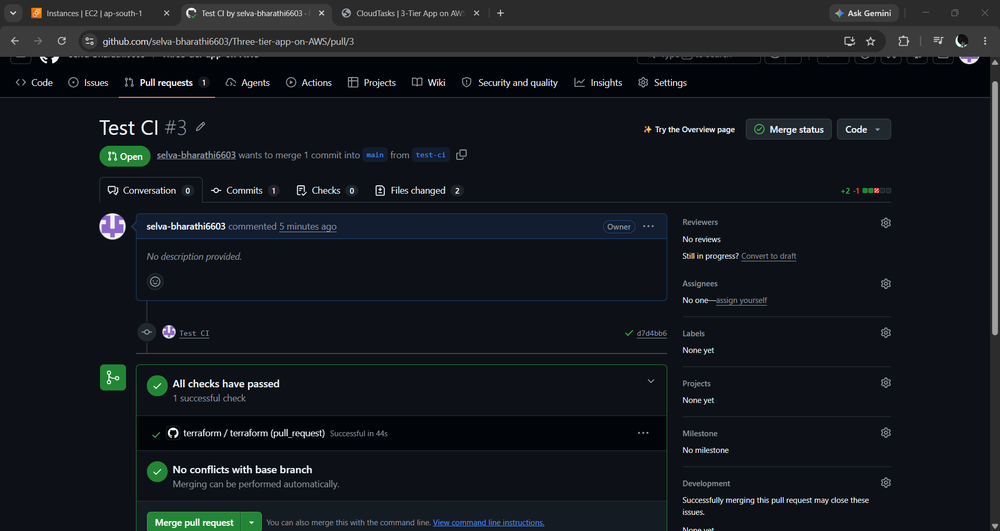

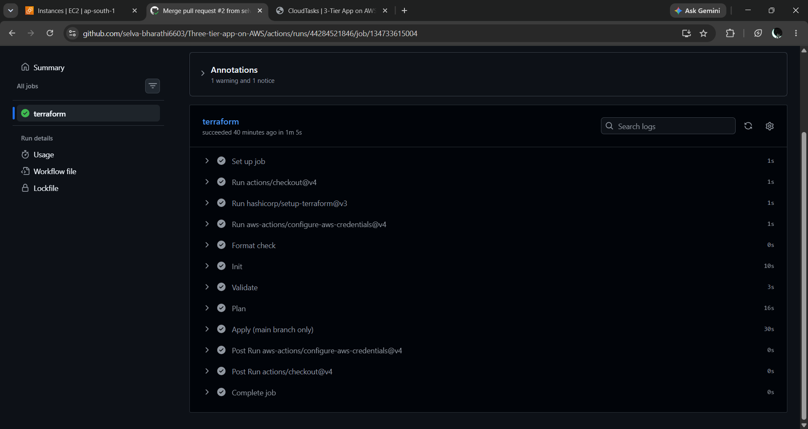

### Updating the frontend

CloudFront caches `index.html`, so clear the cache after deploying a change:

```bash
DIST_ID=$(aws cloudfront list-distributions --query "DistributionList.Items[?Comment=='tier3-dev frontend + API'].Id" --output text)
aws cloudfront create-invalidation --distribution-id $DIST_ID --paths "/*"
```

## Terraform evidence

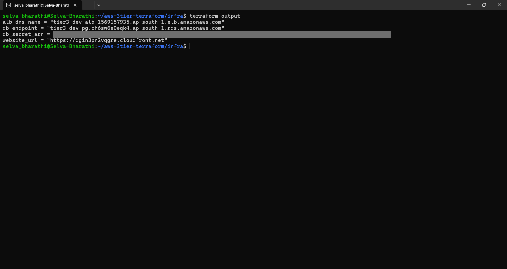

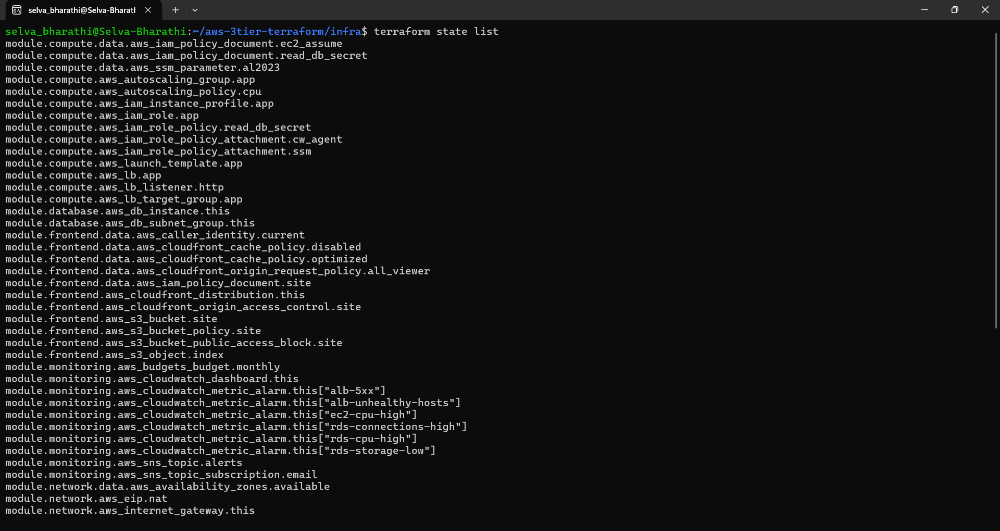

The state tracks 65 entries (56 managed resources plus data sources):

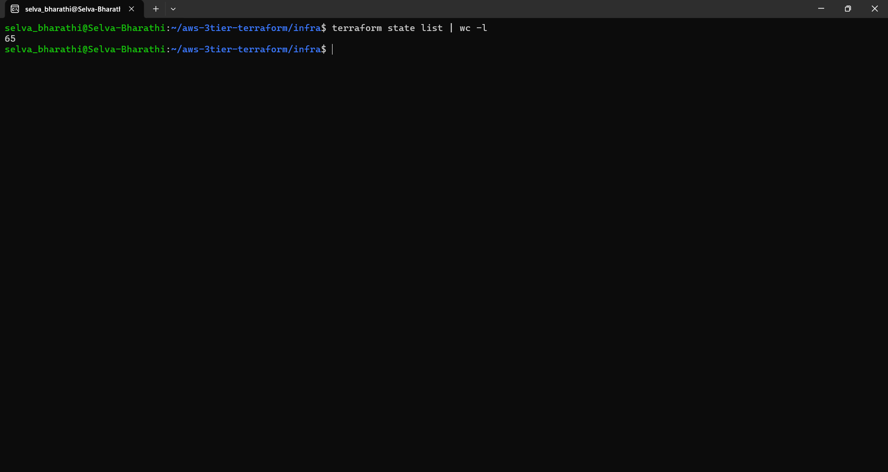

A plan against the live infrastructure reports no drift:

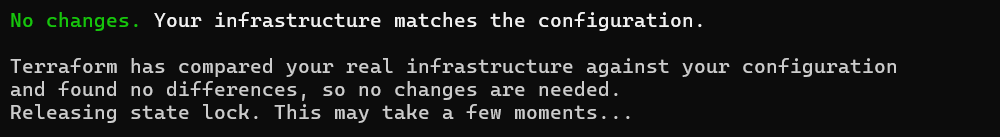

## Problems I solved

### 1. GitHub Actions could not assume the AWS role

The workflow failed with `Not authorized to perform sts:AssumeRoleWithWebIdentity`. The trust policy matched `repo:<owner>/<repo>:*`, and the secret and role ARN were correct. I looked up the `AssumeRoleWithWebIdentity` event in CloudTrail and found that GitHub's token subject now includes permanent numeric IDs, in the form `repo:<owner>@<owner-id>/<repo>@<repo-id>:ref:refs/heads/main`. I re-applied the bootstrap stack with the ID-based repository name and the pipeline went green. This format is also safer, because a renamed or recreated repository cannot take over the role.

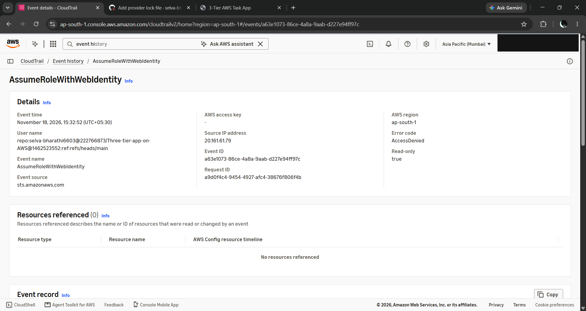

### 2. A target showed "draining" and the group shrank to one server

The Auto Scaling target-tracking policy (CPU at 60 percent) scaled in from two instances to one because traffic was almost idle and the minimum size was 1. I raised the minimum to 2, which keeps one server in each Availability Zone so the app survives an AZ failure, while the policy can still scale out to 3.

### 3. The old page kept showing after a frontend update

CloudFront cached `index.html`. Terraform uploaded the new file to S3, but visitors saw the cached copy until I created a cache invalidation.

### 4. Health checks that do not take the app down

The load balancer checks `/api/health`, which does not touch the database. A short database problem therefore does not mark every server unhealthy and trigger a replacement loop. A separate `/api/health/db` endpoint reports database reachability, and the dashboard shows both.

### 5. Passwords without handling passwords

Instead of generating a password in Terraform (which would end up in state), RDS creates and stores the master password in Secrets Manager (`manage_master_user_password`). The application fetches it at runtime through its IAM role and connects over SSL.

## Design decisions and trade-offs

- **One NAT Gateway and single-AZ RDS** keep costs low. For production use one NAT per AZ and `multi_az = true`.
- **CloudFront to ALB uses HTTP.** Visitors always use HTTPS, but the CloudFront to ALB hop is plain HTTP because there is no custom domain. A custom domain with an ACM certificate would let the origin use HTTPS.
- **The CI role has `AdministratorAccess`** to keep this learning project simple. It should be narrowed to the services Terraform manages.
- **State locking uses S3's native lockfile** (Terraform 1.10 and newer) instead of a DynamoDB table.

## Possible improvements

- Custom domain, ACM certificate and HTTPS to the origin
- AWS WAF on CloudFront, and restrict the ALB to CloudFront's managed prefix list
- Multi-AZ NAT Gateways and a Multi-AZ RDS instance
- Customer-managed KMS keys and automatic secret rotation
- Separate dev and prod environments with their own state
- A narrower CI role and a manual approval step before apply
- Container-based deployment (ECS or EKS) instead of systemd on EC2

## Cleanup

Destroy the main stack first, then the bootstrap stack, because the main stack's state lives in the bootstrap bucket.

```bash
cd infra
terraform destroy
```

The state bucket is versioned, so allow Terraform to empty it before destroying it. Add `force_destroy = true` to the `aws_s3_bucket.state` resource in `bootstrap/main.tf`, then run:

```bash
cd ../bootstrap
terraform apply -var="state_bucket_name=<your-unique-bucket-name>" -var="github_repo=<owner>/<repo>"
terraform destroy -var="state_bucket_name=<your-unique-bucket-name>" -var="github_repo=<owner>/<repo>"
```

Then check the console for leftovers: NAT Gateways, Elastic IPs, load balancers, RDS instances and CloudFront distributions.

## Security notes

- `*.tfstate`, `terraform.tfvars` and `backend.hcl` are in `.gitignore` and must never be committed.
- The screenshots in this repository have the AWS account ID, ARNs and session IDs removed.
- No credentials exist in the code, the pipeline or the instances.

## Author

**Selva Bharathi M**, DevOps and cloud engineer
GitHub: [selva-bharathi6603](https://github.com/selva-bharathi6603) | LinkedIn: [selva_bharathi](https://www.linkedin.com/in/selva_bharathi)
